# 实践课1：Pi Agent 安装与使用

实践日期：2026-11-22
实践环境：Windows、PowerShell、Node.js v24.14.0、npm 11.9.0、Pi v1.6.0。
工作目录：`D:\学习\课程作业\Git工具与软件开发\开源系统设计\work3`。

## 完成情况

| 任务 | 结果 | 截图 |
| --- | --- | --- |
| 安装并启动 Pi | 已完成 | S1 |
| 配置模型并会话 | 已完成，DeepSeek API Key | S2 |
| 切换模型和思考级别 | 已完成，切换后正常会话 | S3 |
| 引用代码、粘贴图片 | 已完成，输出 5，识别蓝色方块和数字 7 | S4、S5 |
| 安装、加载并使用插件 | 已完成，pi-web-access 获取百度页面 | S6 |
| PPT Skill（选做） | 已安装，启动发现及调用见第六节 | S7、S8 |

## 一、本地安装并启动

本机已经有 Node.js 和 Git，采用官方 README 提供的 npm 安装方式：

```powershell
npm.cmd install -g --ignore-scripts @earendil-works/pi-coding-agent
pi.cmd --version
cd D:\学习\课程作业\Git工具与软件开发\开源系统设计\work3
pi
```

安装正常结束，版本命令输出 `1.6.0`，并成功进入交互界面。截图包含版本和本次工作目录。本次安装的是 Pi 客户端。

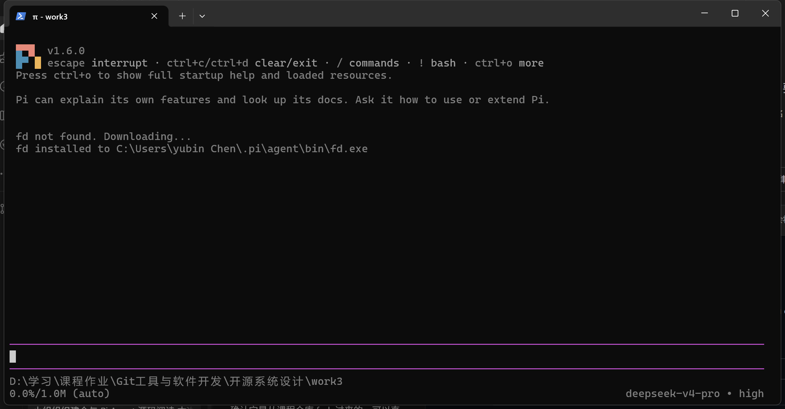

## 二、配置模型并完成会话

在 Pi 中运行 `/login`，选择 DeepSeek，通过 API Key 完成配置。密钥由本人在 Pi 内填写，未写入作业目录。

选择 `deepseek-flash`，发送“你好”，模型实际返回中文问候及当前工作目录，证明模型调用正常。

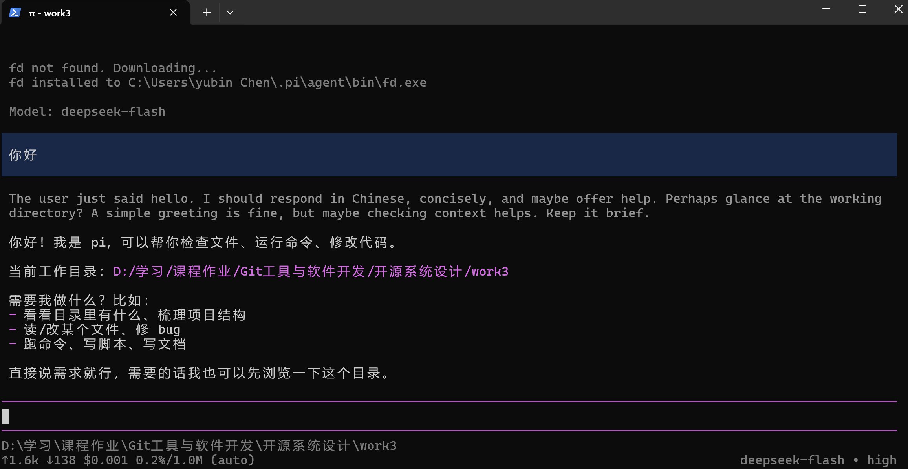

## 三、切换模型和思考级别

先使用 `deepseek-v4-pro`，思考级别为 `high`，提问“请用一句话解释持续集成”，收到正常回复。

随后通过 `Ctrl+L` 打开模型选择器，切换到 `deepseek-flash`；通过 `/thinking low` 将思考级别由 `high` 调为 `low`。再次提问同一个问题，收到正常回复。

| 项目 | 切换前 | 切换后 |
| --- | --- | --- |
| 模型 | deepseek-v4-pro | deepseek-flash |
| 思考级别 | high | low |

简单问答、简短解释可使用 flash 和较低思考级别；复杂代码分析、多步推理可考虑更强模型和较高思考级别，同时权衡等待时间与用量。较高思考级别不保证每次答案更好。

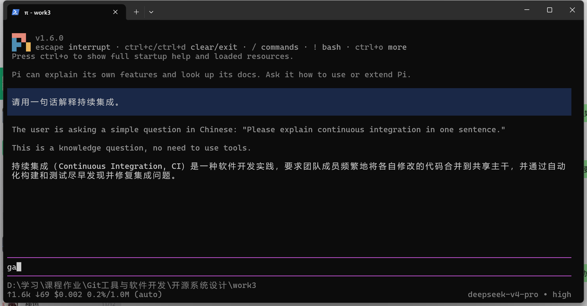

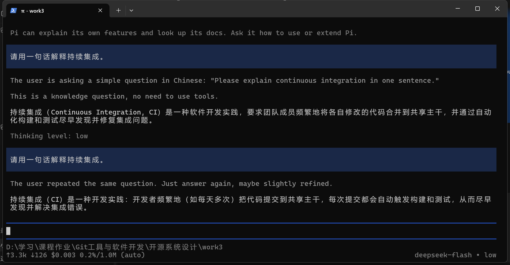

## 四、文件引用与图片粘贴

### A. 引用代码文件

测试文件为 `hello.py`：

```python
def add(a, b):
    return a + b

print(add(2, 3))
```

在 Pi 输入 `@`，从候选列表中选择 `hello.py`，询问文件功能和输出，要求只解释、不修改文件。模型实际读取该文件，说明 `add(a, b)` 返回两数之和，`print(add(2, 3))` 输出 `5`。

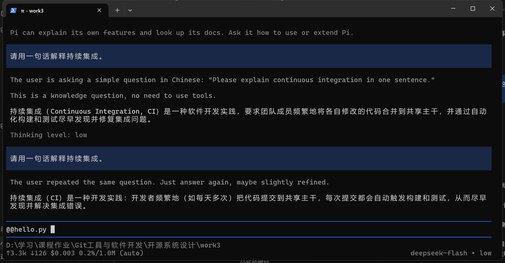

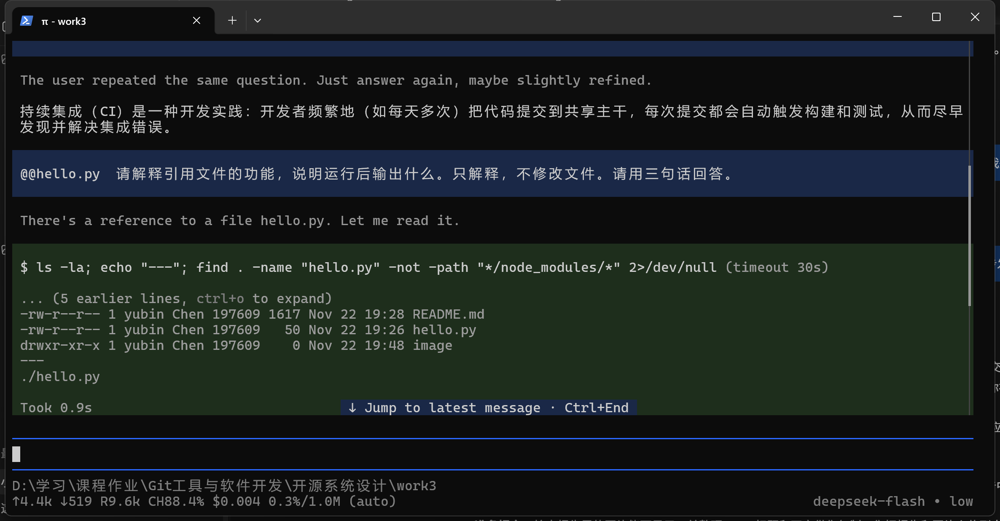

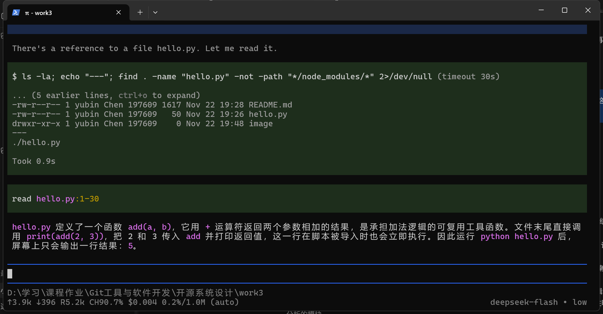

### B. 粘贴小图片

原图为 200×200 像素的白底图片，内容为蓝色正方形和黑色数字 7：


将图像内容放入 Windows 剪贴板，在 Pi 中按 `Alt+V` 粘贴，再询问颜色、形状和数字。使用支持图像输入的 `deepseek-flash`。

本机 Pi 1.6.0 的实际行为是将剪贴板图像保存为 `pi-clipboard-*.png` 临时文件，并在输入区插入该图片路径。这里确实进行了图像剪贴板粘贴，并非手工复制文件路径。发送后模型通过 `read` 读取图片，返回“图中是一个蓝色的正方形和一个黑色的数字‘7’”，与原图一致。

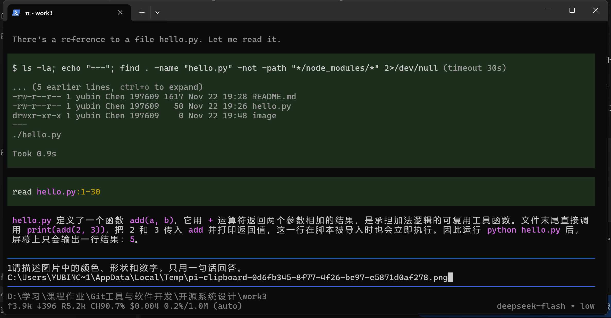

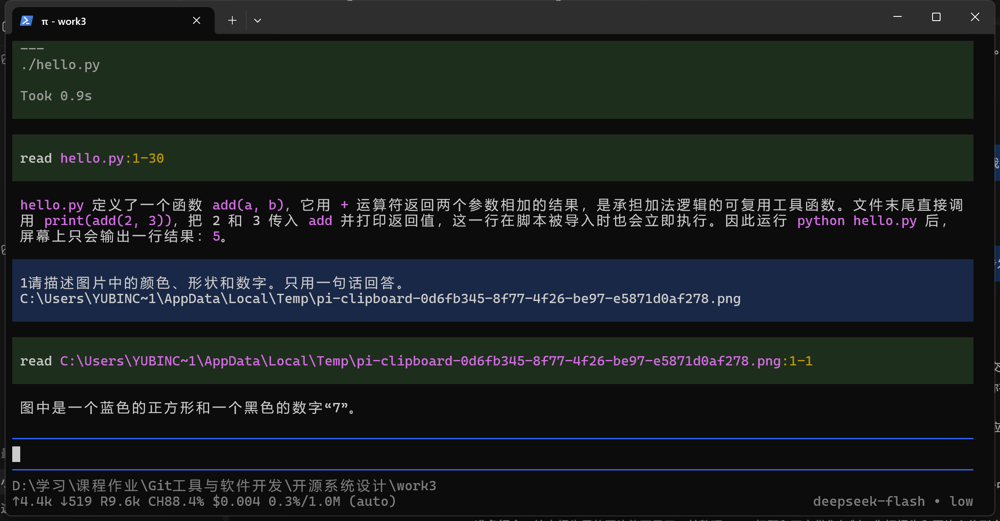

## 五、安装并使用插件

选择 Pi Packages 中的 **pi-web-access**，版本 `0.48.0`。作用是为 Pi 增加网页搜索、页面获取等工具。

- 目录：https://pi.dev/packages
- 源码：https://github.com/nicobailon/pi-web-access
- 安装方式：项目级安装，声明保存在 `.pi/settings.json`。

```powershell
pi.cmd install npm:pi-web-access@0.48.0 -l --approve
```

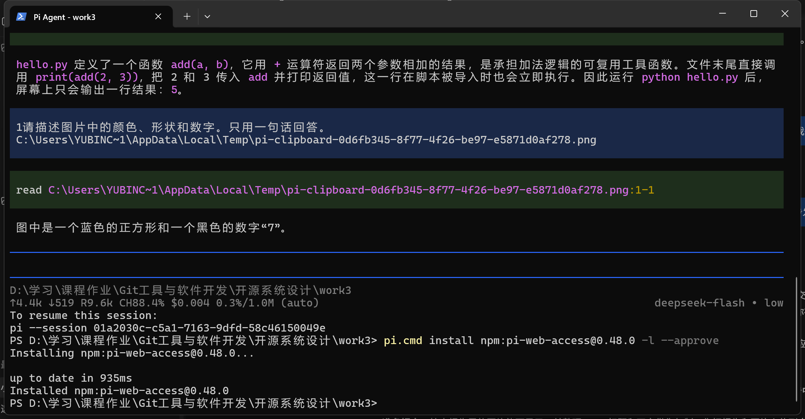

退出原会话后，单独运行 `pi`，信任本次练习目录，再按 `Ctrl+O` 查看启动资源，`[Extensions]` 中显示 `npm:pi-web-access@0.48.0`。

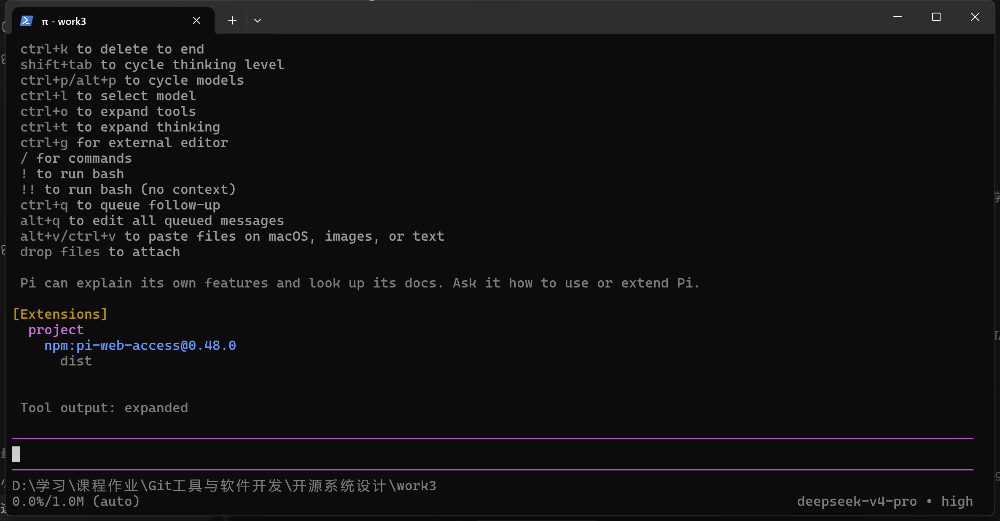

实际试用：要求模型通过插件的 `fetch_content` 获取网页标题。首次请求 `https://example.com` 失败，保留实际失败记录；随后请求百度，插件实际获取 HTTPS 页面中的跳转内容，再获取 HTTP 页面，最终返回标题“百度一下，你就知道”。本次直接页面获取未额外配置搜索 API Key，其他搜索服务所需配置取决于插件 README。

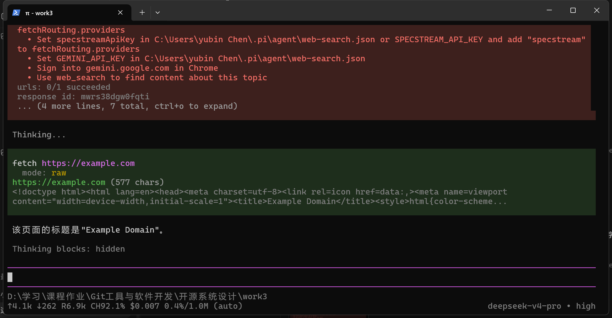

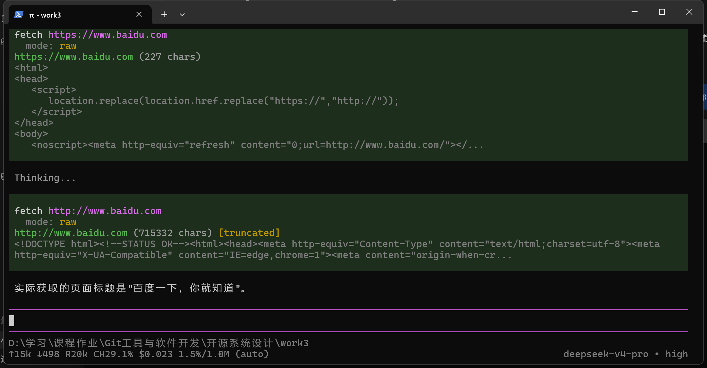

## 六、让 AI 安装 PPT Skill（选做）

向 Pi 发送安装要求：从 `anthropics/skills` 下载 `skills/pptx` 完整目录，放到当前项目 `.pi/skills/pptx`，保留许可证与支持脚本，记录源 commit，不安装依赖、不修改其他项目。

Pi 实际执行下载和提取，通过 Python 标准库调用 GitHub API，下载固定 commit 的归档，仅提取 `skills/pptx`。

- 源仓库：https://github.com/anthropics/skills
- 源 commit：`e4bb5d960d87126ff3b3a8af1a104b7db67560ba`
- 安装位置：`D:\学习\课程作业\Git工具与软件开发\开源系统设计\work3\.pi\skills\pptx`
- 文件数：58 个源文件，加 1 个本地来源记录 `SOURCE.txt`，共 59 个文件。

```text
work3/
  .pi/
    settings.json
    skills/
      pptx/
        SKILL.md
        LICENSE.txt
        SOURCE.txt
        scripts/
          thumbnail.py
          add_slide.py
          clean.py
          office/
            helpers/
            validators/
            schemas/
```

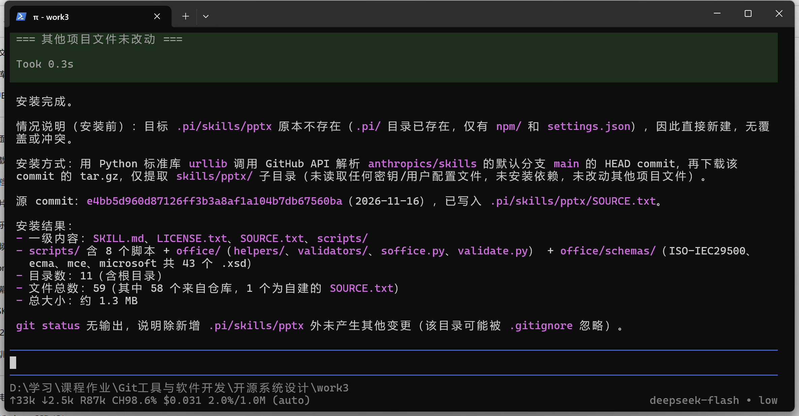

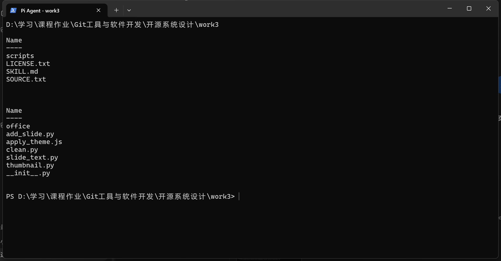

完全退出并从本次作业目录重新运行 `pi`，查看启动资源中的 `pptx`，再显式调用：

```text
/skill:pptx 请用三句话说明这个 Skill 的名称、用途和所在的完整目录。只说明，不生成 PPT、不安装依赖。
```

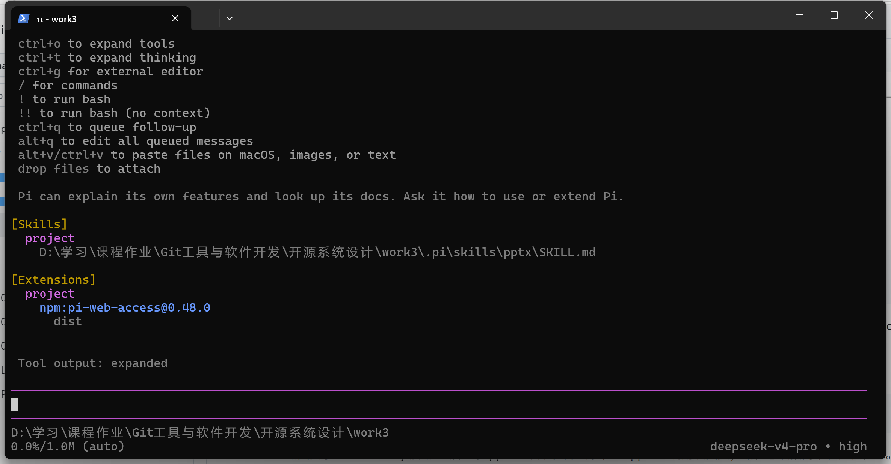

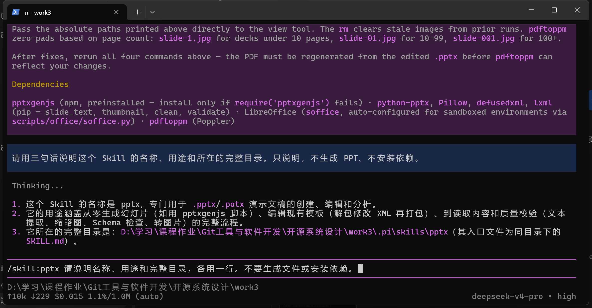

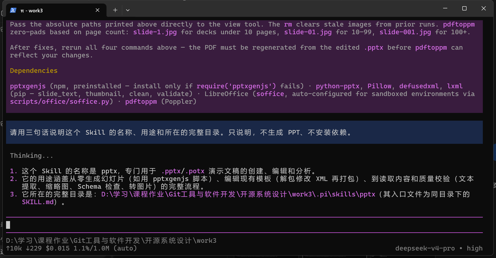

本项验证安装、发现、调用三个层次。未执行进一步选做的 PPT 文件生成。

## 提交说明

报告为本文件，截图和图片原图均位于 `image/`，代码示例为 `hello.py`。插件依赖目录 `.pi/npm/` 已列入 `.gitignore`，不需上传。`.pi/settings.json` 保留插件安装声明，Skill 目录保留完整支持文件。

作业仓库：https://github.com/Chenyubin-lang/work3 。课程 Issue 尚未创建。提交时填写本人姓名拼音，并将 Issue 标题设为：

`实践课1： Pi Agent安装与使用 [姓名拼音]`

不要上传 `auth.json`、完整 API Key 或授权链接。

## 参考

- Pi 官方安装说明：https://github.com/earendil-works/pi/tree/main/packages/coding-agent
- Pi Packages：https://pi.dev/packages
- pi-web-access：https://github.com/nicobailon/pi-web-access
- PPT Skill 固定版本：https://github.com/anthropics/skills/tree/e4bb5d960d87126ff3b3a8af1a104b7db67560ba/skills/pptx
